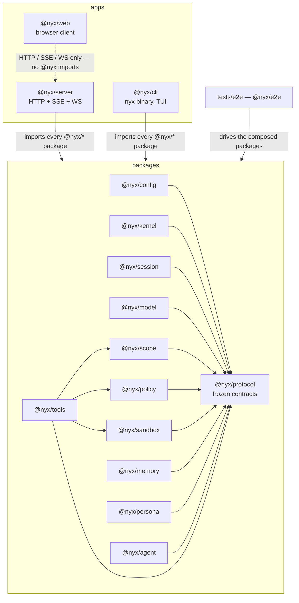
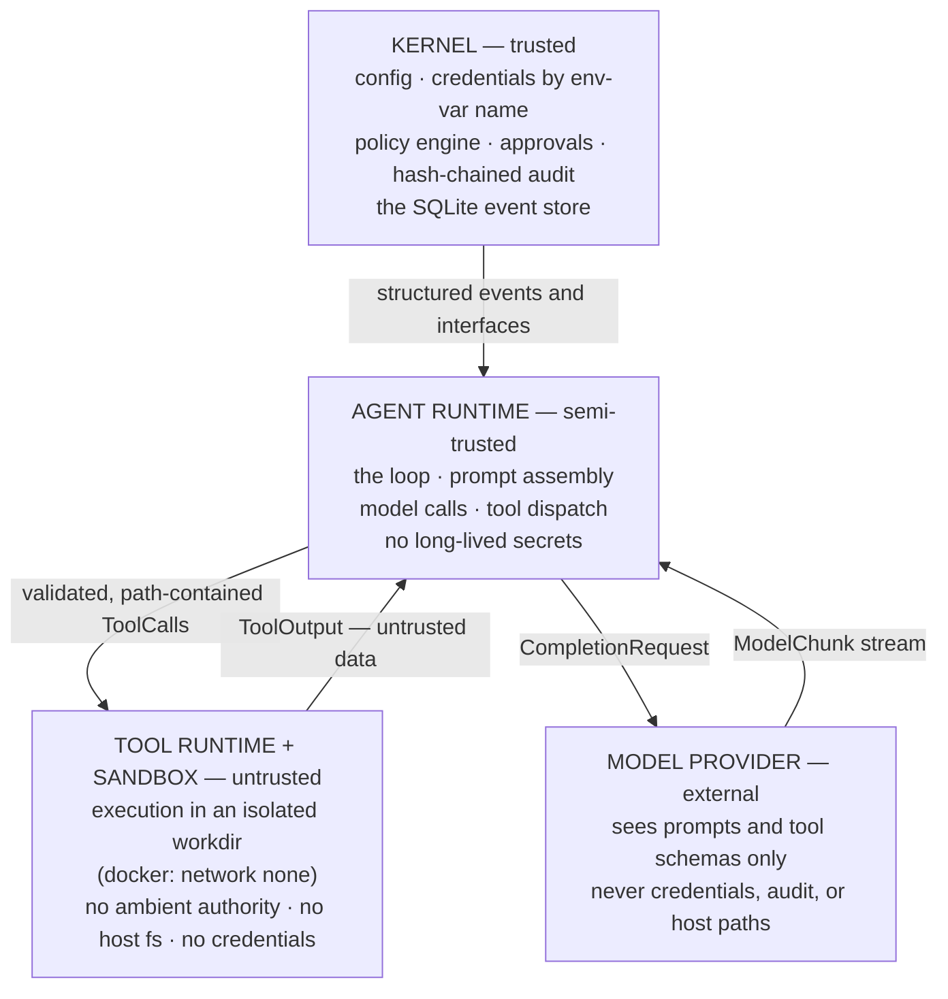

# Architecture

NYX is a local-first, memory-first, security-first personal agent runtime —
**the harness, not the model**. It turns a stateless LLM into a stateful
operator: sessions persist across restarts as append-only event logs, tool
execution happens inside sandboxes behind a deny-first policy broker, memory is
markdown you can read, and the persona is a first-class directory of files. The
model is a commodity plugged in through a provider-neutral router; the harness
is the capability.

NYX runs on the operator's machine. The only outbound network calls are to the
model providers the operator configured — hosted or self-hosted (llama.cpp, LM
Studio, vLLM, Ollama register identically to hosted endpoints). No telemetry,
no analytics, no phone-home.

## The package graph

Twelve library packages, three applications, and an end-to-end test workspace.
`@nyx/protocol` is the frozen contract: every type that crosses a package or
process boundary lives there, and it imports nothing. Dependency direction is
machine-enforced by ESLint `no-restricted-imports` in `eslint.config.mjs`.



What the arrows encode:

- **protocol ← everything.** All shared types plus the Zod boundary schemas
  (`packages/protocol/src/schemas.ts`) live in one dependency-free package.
  Cross-package imports go through `@nyx/<pkg>` (`index.ts` exports) only,
  never a deep path.
- **tools → policy, scope, sandbox.** The tool runtime is the single place that
  composes the enforcement pipeline (see `docs/PROTOCOL.md`). No other package
  may compose policy with execution.
- **agent → protocol only, via DI.** The loop imports types; every collaborator
  — kernel, session store, model router, tool registry and router, policy and
  approval engines, sandbox, memory, persona runtime — arrives through the
  `RunContext` it is handed (`packages/protocol/src/agent.ts`). There is no
  construction inside the loop body.
- **server, cli → everything.** The surfaces compose the runtime and expose it:
  the server as HTTP/SSE/WS (`apps/server`, Hono + ws), the CLI as the `nyx`
  binary (Commander + Ink).
- **web → HTTP only.** The browser client talks to the server's REST/SSE/WS API
  and imports no `@nyx/*` package.
- **tests/e2e** drives the composed packages the way surfaces will: smoke,
  approval, replay, and scope scenarios against the real implementations.

Current state (Phase 0): `protocol`, `config`, `session`, `model`, `scope`,
`policy`, `sandbox`, `memory`, and `persona` are implemented with test suites.
`kernel`, `tools`, `agent`, `server`, `cli`, `web`, and the e2e suites are in
flight against the contracts in `@nyx/protocol` and the specs in this docs set.

## The trust boundary

Four trust zones. Credentials, policy, and audit live in the trusted zone; the
model-facing loop is semi-trusted and holds no long-lived secrets; tool
execution is untrusted and sandboxed; model providers are external by
definition.



- **Kernel (trusted).** May hold configuration, credential env-var names, the
  policy and approval engines, the audit chain, and the event store. May
  evaluate policy, resolve approvals, append events. May not execute
  model-generated code.
- **Agent runtime (semi-trusted).** May assemble prompts, call the model
  router, dispatch tool calls through the runtime, and emit session events. May
  not hold long-lived secrets, bypass the policy broker, or touch the host
  filesystem directly.
- **Tool runtime + sandbox (untrusted).** Handlers receive a `ToolContext`
  whose `sandbox` is their only route to the outside world and whose `emit` is
  their only route to the event log (`packages/protocol/src/tools.ts`). No
  ambient authority; every path is resolved against the sandbox workdir.
- **Model provider (external).** Receives prompts and curated tool schemas
  (`ToolSchema`), never handlers, credentials, audit data, or host paths.

Phase 0 composes these zones inside one server process; the seams are enforced
structurally (dependency direction, the policy broker, the sandbox) rather than
by OS process isolation. The full model, including what Phase 0 does **not**
defend against, is `docs/SECURITY-MODEL.md`.

## Event sourcing

The append-only event log is the only source of truth; everything else is a
projection (`@nyx/session` on better-sqlite3 + drizzle, WAL mode).

- **Append.** `SessionStore.append(session_id, events)` inserts events and
  updates projections in one transaction. `seq` is assigned by the store — a
  single global, monotonic, never-reused `AUTOINCREMENT` across all sessions
  (per-session seqs are strictly increasing but not contiguous under
  interleaved appends). Payloads are stored as canonical JSON (sorted keys,
  `undefined` dropped) so replays reproduce byte-identical values.
- **Projections.** `messages` (from `message.user` / `message.assistant` —
  deltas are not stored), `tool_calls` (status machine `pending → ok | error |
denied`), `approvals` (upsert on `approval.requested`, resolved on
  `approval.resolved`), `usage` (summed from `turn.completed` at read time),
  and `projection_version` (the per-session applied horizon). Projection rows
  are pure functions of `(event payload, seq)` — no clocks, no randomness.
- **Fork.** `fork(session_id, at_seq)` copies the parent's events with
  `seq <= at_seq` into a new session under fresh global seqs (only the
  payload's `session_id` is rewritten), copies owner/persona/engagement, and
  appends a `session.forked` event to the parent's log. The child's prefix is
  identical; both sessions continue independently.
- **Replay and rebuild.** `rebuildProjections()` truncates the projection
  tables and replays the log in global seq order; the result is byte-identical
  to the incremental state (tested to 10,000 events). Reading a session is
  `read(session_id, from_seq)`; live tailing is the `stream()` async iterator,
  which replays from `from_seq` then polls for new events.

## One loop, many surfaces

There is exactly one agent loop (`@nyx/agent`, contract in
`packages/protocol/src/agent.ts`): `AgentLoop.run(input, ctx)` yields every
session event the turn produces, in order, as it happens. A turn is: initialize
context (hook) → assemble the system prompt from the persona runtime → build
the message list from the session projection under the compaction budget →
stream from the model router, appending deltas → for each tool call, run the
enforcement pipeline → append results and continue until no tool calls remain
or the round cap is hit → `turn.completed` (or, after one recovery attempt,
`turn.failed`).

Every surface — server, CLI, SDK, e2e tests — constructs a `RunContext` and
drives the same loop. Only rendering differs. Adding a channel (Phase 1) means
adding a surface, not a loop.

## The scope engine

`@nyx/scope` turns an `Engagement` (the immutable target set bound at session
creation) into a pure `ScopeChecker` closure for the tool runtime. Evaluation
order is expiry → inclusion → exclusion → port policy: an expired engagement
denies everything before any other check; an IP literal must be contained by a
declared CIDR (domains never authorize raw IPs); a hostname must suffix-match a
declared domain on a dot boundary (`example.com` covers `app.example.com`,
never `evil-example.com`); exclusions override inclusions; the port deny list
always wins and an allow list restricts when present. `validateTargets` runs at
session creation so bad CIDRs, domains, and ports are rejected before a session
exists. The engine is deliberately literal-string based — no DNS resolution, no
pinning (see `docs/SECURITY-MODEL.md` for what that does and does not defend).

## Building and testing

```bash
pnpm build                              # turbo run build (all packages)
pnpm test                               # turbo run test (vitest run, non-watch)
pnpm lint                               # eslint .
pnpm format:check                       # prettier --check
pnpm e2e                                # pnpm --filter @nyx/e2e test

# Per package (the working agreement — both must pass before reporting):
pnpm --filter @nyx/<pkg> build
pnpm --filter @nyx/<pkg> test
```

Docker-dependent tests are skippable (`NYX_SKIP_DOCKER=1` or no Docker
available). ESM only, TypeScript strict, SPDX headers on every source file —
see `BUILD-CONVENTIONS.md`.

## Key invariants

| Invariant                         | Meaning                                                                                                                                                                          | Where it lives                               |
| --------------------------------- | -------------------------------------------------------------------------------------------------------------------------------------------------------------------------------- | -------------------------------------------- |
| Frozen policy                     | Structural invariants are hardcoded and evaluated before config rules; nothing can weaken them                                                                                   | `@nyx/policy` `PolicyEngineImpl`             |
| Four hooks                        | The entire editable behavioral surface is `context.initialize`, `action.before`, `action.after`, `feedback.recover`; hooks return structured effects, the kernel interprets them | `@nyx/protocol` `hooks.ts`                   |
| Output separation                 | The component being judged never writes the judgment: verdicts, approvals, and audit are written by the policy engine, and projections are pure functions of events              | `@nyx/policy`, `@nyx/session`                |
| Event sourcing                    | Append-only log is the only truth; all state is a rebuildable projection; replay and fork are free                                                                               | `@nyx/session`                               |
| Router / registry / runtime split | Tool selection, catalog, and execution are three objects; the model sees a curated `ToolSchema`, never handlers. Same shape for models: registry / router / providers            | `@nyx/protocol` `tools.ts`, `model.ts`       |
| Deny-first                        | `deny > ask > allow`; unknown actions escalate to ask; risk tiers R0–R4                                                                                                          | `@nyx/policy`                                |
| Trust boundary is structural      | Credentials are env-var names resolved at call time; the sandbox has no ambient authority; the loop holds no long-lived secrets                                                  | `@nyx/config`, `@nyx/model`, `@nyx/sandbox`  |
| Isolation over coordination       | Tool execution happens inside a sandbox; path containment is enforced centrally in the tool runtime and re-enforced by providers                                                 | `@nyx/sandbox`, `@nyx/tools`                 |
| Progressive disclosure            | Catalogs up front, bodies on demand: memory titles, skill one-liners, tool one-liners in the prompt                                                                              | `@nyx/persona`, `@nyx/protocol` `persona.ts` |
| One loop, many surfaces           | A single `AgentLoop`; every surface drives it via `RunContext` DI                                                                                                                | `@nyx/agent`, `@nyx/protocol` `agent.ts`     |
